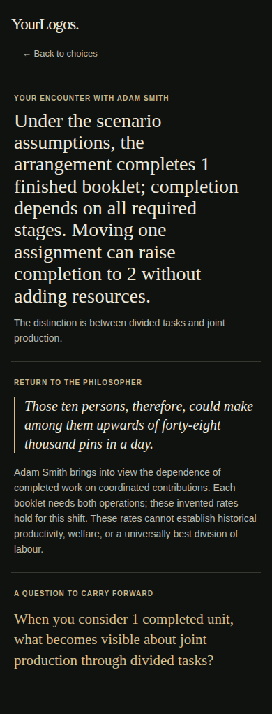
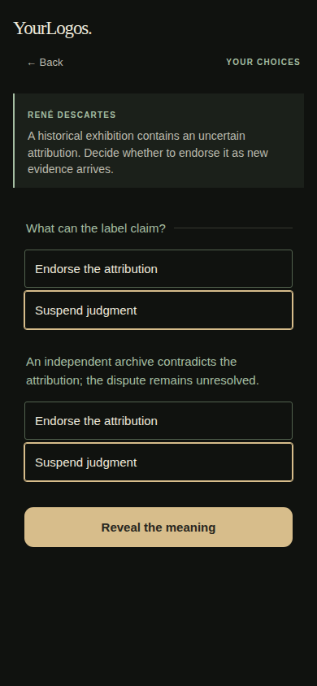

# Philosophical Engine v1.8 — founder review

Recommendation: review the isolated prototype; **do not approve production or declare full acceptance yet**. Engineering verification is not evidence of learning effectiveness or independent human philosophical approval.

PR #165 remains stacked on #164 (Semantic Reasoning v1.2), above #163 (Reasoning Kernel v1.1). Application/code checkpoint: `16e77a1750a633f50df8ae47cf0822cfbf4fd4d0`. No merge, production deployment, authentication change, migration, paid model or user-data transmission was introduced.

## Architectural changes

The existing constraint solver, decision transition evaluator, Expression Engine adapter and three-stage consumer shell remain in place. No philosopher-ID dispatch was added.

- Decision options distinguish observable `action`, optional `intention`, `commitments`, and `effects`. Ordered events retain information available before the decision and information revealed afterward.
- `commitmentDomains` declares states and explicit opposition pairs. Only transitions across declared oppositions establish genuine revision. Different action names alone do not. Undeclared relations remain unresolved; unresolved assent cannot produce an established assent reading. Assent revision is scoped to `assentField`, not changes in unrelated commitments. One declaration does not imply maintenance.
- `variables` declares ownership and kind. Own-action effects cannot assign external variables. Occurred events only admit true, so later choices cannot erase a past apology. Agency requires a declared externally owned outcome.
- `semantic.selection` declares the source's central operation, optional alternatives and educational purpose. Selection first filters warranted, path-evidenced central candidates, then secondary candidates; missing or ambiguous candidates decline. The trace exposes central/secondary/observation roles, evidence presence, classification, assumptions and the curated provenance. This is an inspectable editorial contract, **not an algorithmic proof of source fidelity**. No opaque numerical score or universal priority list is used.
- Observation, consequence and selected meaning remain separate. Thoreau's intention gap survives as an observation but does not displace conversion. Smith's dependency reading includes an evidenced feasible output improvement when available.
- `meaning/1.2` remains the compatible packet interface, extended with events, semantic revisions, occurred facts and selection trace. Existing Dillard/Kierkegaard and kernel integrations are retained.

Structured source work remains necessary: concepts, central relation, suitable scenarios, rates, assumptions, semantic ownership, opposition pairs, prohibited inference boundaries and editorial review. The engine cannot prove that arbitrary prose agrees with those annotations. It does not claim universal quotation compatibility.

## Before and after

| Case | Before | After / reproducible evidence |
| --- | --- | --- |
| Epictetus offer → space | A changed serialized response could count as a commitment revision. | No semantic revision; ordered action history retained; `apologyOffered` stays true; forgiveness remains external. Semantic and D1 tests. |
| Explicit commitment withdrawal | Arbitrary field inequality drove revision. | Declared opposition is required; unrelated commitment changes cannot alter assent classification. |
| Thoreau with intended lamp omitted | Fixed ranking selected intention gap before conversion. | Conversion is central: four extra working hours for the selected purchases. Intention gap remains observable, without a psychological inference. |
| Smith imbalanced tasks | Generic completed output; little use of a feasible alternative. | Dependency plus modeled gain with the same resources, conditional on invented rates and indispensable stages. |
| Discover Decision Map entry | Adapter overwrote initial evidence array with `{path: ...}`; consumer failed before interaction. | Only Trade-Off receives allocation defaults; Decision Map retains its evidence array. Full consumer matrix covers both decision scenarios. |

## Consumer-test incident and correction

Reviewed commit `dca9275ecbf061fd894742034dc5fe9288d0ecf2` had an empty remote consumer test while a nonempty local test existed. The exact historical write failure is not established; there is no evidence that the HTML builder erased it. Executing an empty Node file exits successfully, so the passing workflow did not establish consumer coverage.

The replacement executes the actual generated `experiments/discover-v17.html`, with sixteen explicit scenario/viewport results and a final count assertion. CI also rejects an empty test file. Uploads were checked against local Git blob hashes to avoid another local/remote discrepancy.

The first new run failed because its workshop assertion overlooked intentional two-choice reallocation; corrected to verify conservation. The second run exposed the actual Decision Map adapter defect above. At `935e8dd`, all six workflows and all sixteen consumer journeys passed. Hosted Thoreau and repaired hosted Epictetus journeys were also completed through the final reading. That does not prove why the previous independent hosted attempt failed; its original trace is unavailable.

## Verification and scope

Local command:

```sh
node scripts/build-encounter-v1.mjs --check
node --test tests/scenario-transfer-v02.test.mjs tests/encounter-v1.test.mjs tests/kernel-v11.test.mjs tests/semantic-v12.test.mjs tests/semantic-v18-holdout.test.mjs
node tests/discover-v17-browser.mjs
```

45 Node tests pass, including legacy scenarios and review-driven negative cases. Browser execution is performed in GitHub Actions because local Chromium launch is blocked by the execution sandbox. Consumer matrix: four scenarios × 320, 390, 430, 1024 pixels. Checks cover Like/Discover independence, introduction content, incomplete choices, invalid money allocations, conserved workshop allocation, downstream invalidation, back/Escape navigation, keyboard entry/focus, 44px interaction targets, three final sections, question last, absence of research controls/persistence panels, overflow, page errors and external requests. Reduced-motion mode is enabled. Older browser suites also run. This is not a complete WCAG audit or a physical device test.

## Expression contract and examples

[Exact inputs, selected claims, selection traces and all sixteen voice outputs](v18-output-examples.json) are generated directly from the implementation. Voice modes vary the explanatory lens, source sentence and question, while retaining the selected claim, classification, evidence, assumptions and boundary. No quotation-specific endings were introduced.

Copy policy: aim for approximately 80–120 words across all three sections, excluding labels/quotation; allow concise readings around 65–80 rather than padding. Suggested section ranges are 20–45 for encounter, 35–65 for source/limits, and 12–25 for the question. A 160-word safety ceiling declines for editorial review instead of silently truncating caveats. These are editorial guidelines, not proof of prose quality. Blind rhetorical review is outstanding; templates may still sound formulaic.

## Independent transfer and philosophical review

[Independent AI review, original holdout specifications, findings and re-review](v18-independent-review.md). This is a separate reviewer in the development session, **not human approval or a blinded study**.

Initial frozen implementation passed four independently proposed holdout scenarios plus incompatibility coverage: two-resource purchases; three indispensable production stages; distinct histories converging on giving space; convergent evidence routes with prerequisites, irreversible publication and correction. No case-specific kernel logic was added for that first run. Subsequent review exposed cross-domain assent leakage and incomplete event/ownership contracts; reusable fixes followed. Later runs are regression tests, not newly unseen evidence. D1 now asserts persistent apology history. The two new Trade-Off cases remain variations within the existing philosophical sources, not proof of broad domain independence.

Negative coverage includes wrong mechanism, missing agency warrant, infeasible independent constraints, unavailable evidence, closed alternatives, external assignment and erased events. False free-text labels and philosophically wrong mappings can still pass if trusted annotations falsely warrant them; these require source editorial review. No keyword-based pretend understanding was added.

## Acceptance matrix

PASS means the stated bounded engineering behavior was observed, not universal philosophical validity. All rows refer to PR #165 and the application checkpoint above.

| Criterion | Status | Evidence / example | Remaining limitation | Severity |
| --- | --- | --- | --- | --- |
| Reusable architectural generalization | PASS | Shared kernels, four transfer fixtures, no quote-ID inference dispatch | Curated semantic/source contracts required; finite discrete models | P1 scope limit |
| Trade-Off reasoning correctness | PASS | Two constraints, zero stage, non-zero-sum kernel tests; Thoreau/Smith | Model truth and rates are curated; no global optimization guarantee | P1 scope limit |
| Decision Map semantic correctness | PASS | Explicit opposition, scoped assent, evidence prerequisites, closure, persistent events | Arbitrary prose/annotation agreement not machine-verified | P0 editorial gate |
| Genuine tension validation | NOT VERIFIED | False sequential contradiction fixed; ownership/unknown relations rejected | Human significance and source-model compatibility still curated | P0 |
| Source-sensitive meaning selection | PASS | Thoreau conversion; Smith dependency; agency and assent selected through explicit contracts | Centrality prescribed by editors; broader competing-candidate educational ranking unvalidated | P1 |
| Philosophical source fidelity | NOT VERIFIED | Six-source independent AI review with limits | Human source/analogy approval, including Descartes and Smith | P0 |
| Evidence and uncertainty preservation | PASS | Caveats in outputs; domain-scoped evidence, negative tests, invariant claim/evidence across modes | Cannot validate arbitrary authored factual premises | P1 scope limit |
| Expressive variation | NOT VERIFIED | Four compositions and exact output examples | Blind mode identification, naturalness and educational depth review absent | P1 |
| Three-stage UX fidelity | PASS | Consumer journey and three final sections, ending with question | Long-reading comprehension remains untested | P1 |
| Consumer-browser regression coverage | PASS | Nonempty sixteen-journey test; actual generated consumer; CI evidence | Hosted wrapper is separately spot-checked, not full matrix | P1 scope limit |
| iPhone and accessibility behavior | NOT VERIFIED | Chromium widths, reduced motion, keyboard/focus, touch-target assertions | Physical Safari, VoiceOver and full accessibility audit outstanding | P0 acceptance gate |
| First-time-user comprehension | NOT VERIFIED | Review protocol below | No first-time human participants | P0 |
| Production readiness | FAIL | Isolated draft only; technical evidence available | Above acceptance gates remain open; founder approval required | P0 |

## Human review checklist

- Review primary source versus teaching analogy for all six philosophers. In particular, confirm that Smith's model only illustrates complementary stages and that documentary checks do not imply Cartesian certainty.
- Blindly compare four voices for the same packet: identify rhetorical differences, verify unchanged claim/evidence/uncertainty, and flag generic or misleading questions.
- On a physical iPhone in Safari, complete all four scenarios, revise earlier decisions, test range dragging, back/Escape where applicable, zoom, safe areas and VoiceOver reading/focus order.
- Give first-time readers an encounter without coaching. Ask afterward: what did you decide, what followed, what is the philosopher arguing, and how did this experience clarify it? Record misunderstanding and non-completion, not just successful rendering. Do this outside the consumer flow; add no survey or data collection to the app.
- Founder may approve or reject the prototype after reviewing evidence. Production remains unauthorized.

## Final CI and design evidence

All six workflows passed on application commit `16e77a1750a633f50df8ae47cf0822cfbf4fd4d0`:

- [Encounter: 45 Node tests, legacy browser suites, sixteen consumer journeys](https://github.com/OWEF/Yourlogos/actions/runs/43178129551)
- [Discover regression](https://github.com/OWEF/Yourlogos/actions/runs/43178129545)
- [Studio checks](https://github.com/OWEF/Yourlogos/actions/runs/43178129762)
- [V2.4 checks](https://github.com/OWEF/Yourlogos/actions/runs/43178129509)
- [Insight + Expression pilot](https://github.com/OWEF/Yourlogos/actions/runs/43178129506)
- [Philosophical Reasoning Engine](https://github.com/OWEF/Yourlogos/actions/runs/43178129501)

[Full screenshot and machine-readable browser-results archive](v18-design-evidence.zip). This archive contains twelve 390px consumer screenshots (introduction, interaction, reading for each scenario), plus the inherited suite's six foundation comparison screenshots. The foundation comparison is not a before/after screenshot of the v1.8 philosophical defect; use the explicit before/after evidence table for that correction. No visual redesign was made. Inspected mobile captures retain the dark/ivory/gold/sage design and section hierarchy; long reading headlines scroll vertically and remain an editorial pacing concern. Physical-device typography acceptance is still open.




